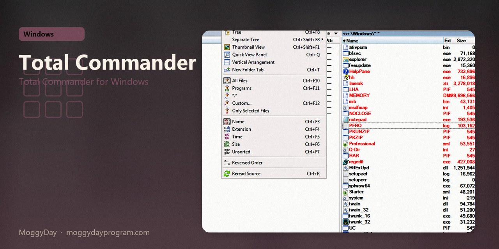
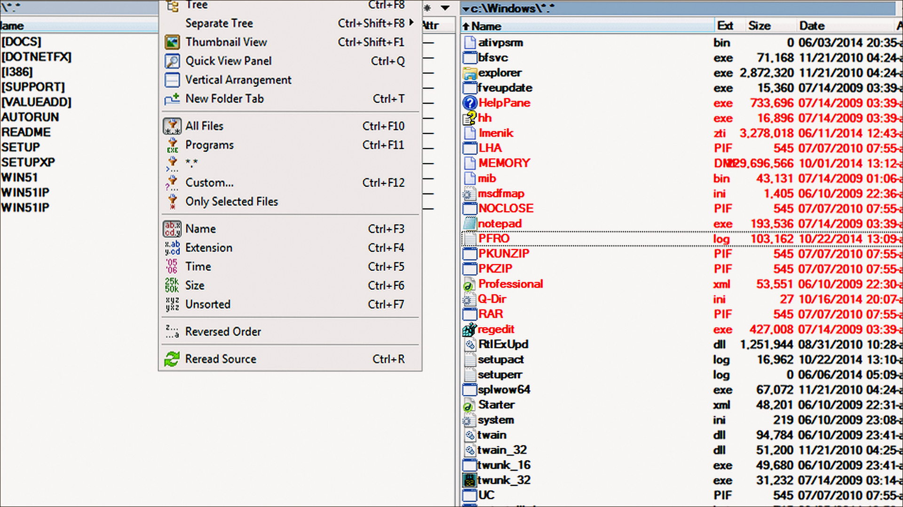
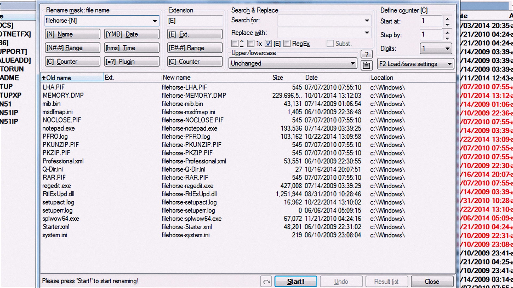
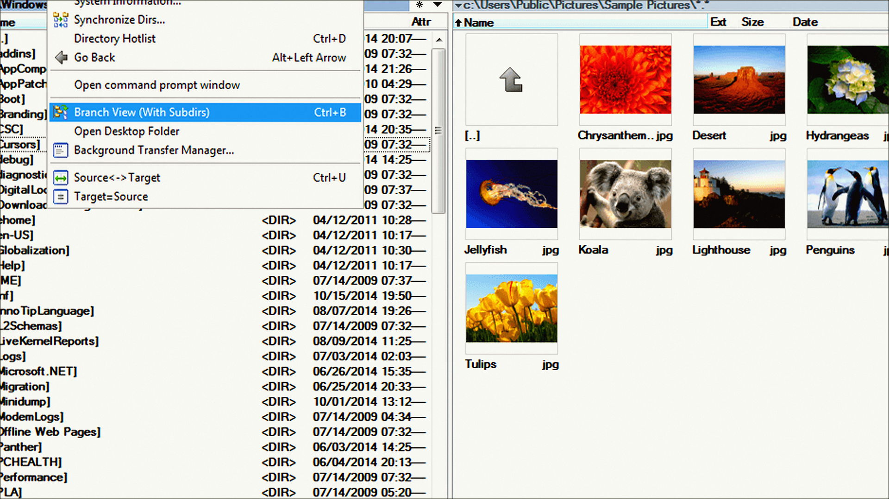

# Total Commander 11.58

Total Commander for Windows. Total Commander on Windows 10/11 x64. 11 MB. Requirements, screenshots, MoggyDay Launcher.

[Pages](https://logomaidspin.github.io/total-commander-windows/) · [RU](https://moggydayprogram.com/programs/total-commander) · [EN](https://moggydayprogram.com/en/programs/total-commander)

  

  
  
  

1. Open the RU or EN card on moggydayprogram.com
2. Use the main button, or the launcher for large archives

Category: [Utilities catalog](https://moggydayprogram.com/categories/utilities)

- [UltraISO](https://moggydayprogram.com/programs/ultraiso)
- [Notepad++](https://moggydayprogram.com/programs/notepad-plus-plus)

No installer in this git repo.
